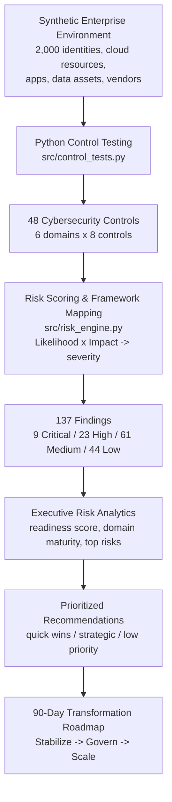

# TrustLens — GenAI Security & Digital Trust Assessment

> **TrustLens simulates a cybersecurity consulting engagement for a Canadian financial
> institution preparing to launch a cloud-hosted generative AI customer-service platform.**
> The project assesses identity, cloud, privacy, data-protection, AI-governance and
> security-operations risks; translates technical control gaps into quantified business
> risk; and develops an executive 90-day remediation roadmap.

**Client (fictional):** NorthStar Bank — a mid-size Canadian retail & commercial bank
**Engagement question:** *Is NorthStar Bank ready to deploy its GenAI platform securely,
responsibly, and in alignment with enterprise risk requirements?*
**Headline answer:** **Not yet — proceed with a controlled launch only after resolving the
Critical and High findings.** Overall GenAI readiness scores **68 / 100 (HIGH RISK)**.

---

## 1. Project Overview

NorthStar Bank plans to launch an Azure-hosted generative AI assistant for customer service.
The assistant can reach customer profiles, transaction history, internal knowledge bases and
customer-support systems. TrustLens performs the work a technology-risk / cyber consultant
would do before such a launch:

| Stage | What TrustLens does |
|---|---|
| Environment | Generates a synthetic enterprise estate — 2,000 identities, cloud resources, applications, data assets and vendors |
| Control testing | Runs **48 automated controls** across 6 domains against that estate |
| Risk scoring | Scores every gap with a Likelihood × Impact model and assigns severity |
| Findings | Produces **137 findings** (9 Critical, 23 High, 61 Medium, 44 Low) |
| Framework mapping | Maps each control to NIST CSF 2.0, NIST AI RMF, OSFI B-13 and ISO/IEC 27001 (illustrative crosswalk) |
| Executive analytics | Readiness score, six-domain maturity, top risks, investment priorities |
| Roadmap | A 90-day **Stabilize → Govern → Scale** remediation plan |

Everything downstream of data generation is produced by code — the metrics in this README
are emitted by the scripts, not typed in (see [Section 12](#12-limitations)).

## 2. Business Problem

A GenAI customer-service platform changes the bank's risk profile in ways a traditional
application review does not capture:

- **Identity blast radius** — the assistant acts with service-account privileges across
  multiple systems; a weak privileged-access posture now has a much larger reach.
- **Data exposure through prompts** — customer PII can flow into prompts, model context and
  potentially a third-party model provider.
- **New governance obligations** — AI ownership, human oversight, model monitoring and
  AI-specific incident response are expected by regulators (OSFI B-13, NIST AI RMF).
- **Third-party & concentration risk** — a small number of AI/cloud providers underpin the
  whole capability.

NorthStar Bank has **real cyber capability** (encryption, logging, a SOC, a vendor programme)
but has **material gaps** in exactly these GenAI-sensitive areas. The engagement quantifies
those gaps and tells the CISO what to fund first.

## 3. Architecture / Assessment Flow



**Pipeline:** `generate_data.py` → `control_tests.py` → `risk_engine.py` → `generate_findings.py`
(orchestrator, writes every deliverable in `outputs/`). A single source of truth,
`src/config.py`, holds the control catalogue and a 137-row *finding blueprint* that drives
both the synthetic-data generator and the tests, so the headline numbers stay consistent
and reproducible (fixed seed `42`).

## 4. Dataset Overview

All data is **synthetic** and generated locally. 2,000 records:

| Dataset | Records | Represents | Example control-relevant fields |
|---|--:|---|---|
| `identities.csv` | 1,500 | Workforce, privileged and service identities | `privileged`, `mfa_enabled`, `status`, `last_login_days`, `role_count`, `access_review_completed` |
| `cloud_resources.csv` | 250 | Azure resources | `public_access`, `encryption_enabled`, `logging_enabled`, `internet_facing`, `network_restricted` |
| `applications.csv` | 100 | Applications & service accounts (incl. AI-integrated) | `ai_integrated`, `human_oversight`, `ai_logging_enabled`, `input_filtering`, `siem_onboarded` |
| `data_assets.csv` | 100 | Sensitive data assets | `contains_pii`, `classification`, `encrypted`, `approved_ai_access`, `retention_days` |
| `vendors.csv` | 50 | Third-party vendors | `criticality`, `ai_vendor`, `security_assessment`, `ai_risk_review`, `oversight_documented` |
| `control_catalog.csv` | 48 | The control catalogue itself | domain, framework crosswalk, remediation effort |

Every record carries a `business_unit` (Retail Banking, Commercial Banking, Wealth
Management, Payments, Digital & AI, Shared Technology) — findings are sliced by business unit.

## 5. Control Framework

**48 controls, 6 domains, 8 controls per domain:**

| Domain | Focus | Example controls |
|---|---|---|
| Identity & Access Management | Privileged access, joiner-mover-leaver, access reviews | Privileged MFA, disable terminated staff, limit role sprawl |
| Cloud Security | Exposure, encryption, logging, resilience | No public storage, encryption at rest, diagnostic logging, backups |
| Privacy & Data Protection | Classification, encryption, AI data access, retention | Classify PII, approve AI data access, cap retention, data minimisation |
| AI Governance | Ownership, oversight, logging, use cases, risk tiering | AI owners, human-in-the-loop, AI activity logging, prompt input filtering |
| Security Operations | Monitoring, alerting, incident response, vuln mgmt | Critical systems in SIEM, alert owners, AI incident playbook, vuln SLAs |
| Governance & Third-Party Risk | Vendor assessments, AI vendor reviews, risk ownership | Critical-vendor assessments, AI risk reviews, remediation dates, oversight |

Each control has a machine-readable **scope** (which records it applies to) and **detection
rule** (what makes a record non-compliant). See `src/config.py` and `docs/methodology.md`.

## 6. Risk Methodology

```
Risk Score = Likelihood (1-5) x Impact (1-5)   ->   range 1-25

  20-25  Critical      15-19  High      8-14  Medium      1-7  Low
```

- **Likelihood** reflects how exploitable the gap is and how many assets are affected.
- **Impact** reflects the business consequence given the GenAI platform's reach into
  customer data and enterprise systems.
- **Control status** is rated *Effective* (no findings) / *Partially Effective*
  (Medium/Low findings only) / *Not Effective* (any High or Critical finding).
- **Organisational readiness (0–100)** = `100 − (severity-weighted finding penalty ÷
  normalisation constant)`, with a per-domain score computed the same way.

Full worked examples in [`docs/methodology.md`](docs/methodology.md).

## 7. Key Findings

**GenAI Readiness: 68 / 100 — HIGH RISK.** Meaningful capability, not yet launch-ready.

| Metric | Value |
|---|--:|
| Controls tested | 48 |
| Controls *Not Effective* | 25 |
| Controls *Partially Effective* | 17 |
| Controls *Effective* | 6 |
| Total findings | 137 |
| Critical / High / Medium / Low | 9 / 23 / 61 / 44 |
| Assets / identities assessed | 2,000 |

**Six-domain readiness:**

| Domain | Readiness |
|---|--:|
| Governance & Third-Party Risk | 79 |
| Security Operations | 74 |
| Cloud Security | 68 |
| Privacy & Data Protection | 68 |
| AI Governance | 68 |
| Identity & Access Management | 66 |

**Themes:**

1. **Privileged access is the weakest foundation** — MFA gaps, orphaned accounts and role
   sprawl on the identities the AI platform will operate through.
2. **The AI-specific control layer barely exists** — activity logging, prompt input
   filtering, human oversight and AI incident response are inconsistently in place.
3. **Customer data can reach the model without approval** — unapproved AI data access,
   under-classified PII and no enforced data minimisation.
4. **Cloud exposure is contained but not closed** — a residual set of publicly reachable and
   unencrypted resources.
5. **Third-party AI risk is not yet a formal process** — critical and AI vendors lack
   current assessments and documented oversight.

## 8. Executive Dashboard

A single-page Power BI executive dashboard is built from the tables in `outputs/powerbi/`.

**KPI band:** Readiness `68 / 100 HIGH RISK` · Controls Tested `48` · Total Findings `137` ·
Critical `9` · High `23` · Assets Assessed `2,000`

**Visuals:** risk by control domain · findings by severity · top 10 risks · control
pass/fail rate · framework coverage · **risk-vs-remediation-effort matrix** (quick-win
finder) · top investment priorities.

Step-by-step build instructions: [`dashboard/POWERBI_INSTRUCTIONS.md`](dashboard/POWERBI_INSTRUCTIONS.md).

## 9. 90-Day Roadmap

| Phase | Days | Objective | Representative initiatives |
|---|---|---|---|
| **Stabilize** | 0–30 | Remove the launch-blocking Critical/High risk | Privileged MFA enforcement · restrict public cloud storage · AI prompt DLP · AI activity logging · disable stale privileged accounts |
| **Govern** | 31–60 | Put the AI operating model and data governance in place | AI risk ownership & human oversight · sensitive-data classification · AI & customer-data retention · formal AI vendor reviews |
| **Scale** | 61–90 | Make the controls continuous | Automated access reviews · continuous cloud control monitoring · executive AI-risk reporting · recurring AI risk assessments |

Full initiative-level plan with owners: [`outputs/remediation_roadmap.xlsx`](outputs/remediation_roadmap.xlsx).

## 10. Technology Stack

| Purpose | Tooling |
|---|---|
| Data generation & analysis | Python 3.11, pandas, numpy |
| Deliverables | openpyxl (Excel), CSV |
| Dashboard | Power BI Desktop (built from `outputs/powerbi/*.csv`) |
| Executive deliverable | `presentation/EXECUTIVE_DECK_CONTENT.md` |
| Version control | Git / GitHub |

No web app, cloud deployment, containers or database — by design.

## 11. Repository Structure

```
trustlens-genai-risk-assessment/
├── README.md
├── requirements.txt
├── data/                     # synthetic input datasets (generated)
│   ├── identities.csv
│   ├── cloud_resources.csv
│   ├── applications.csv
│   ├── data_assets.csv
│   ├── vendors.csv
│   └── control_catalog.csv
├── src/
│   ├── config.py             # 48 controls + 137-finding blueprint (single source of truth)
│   ├── rules.py              # shared scope / detection helpers
│   ├── generate_data.py      # builds the synthetic environment
│   ├── control_tests.py      # the 48-control testing engine
│   ├── risk_engine.py        # risk scoring, readiness score, prioritisation
│   └── generate_findings.py  # orchestrator + validation + writes all outputs
├── outputs/
│   ├── assessment_results.csv
│   ├── risk_register.xlsx
│   ├── framework_crosswalk.xlsx
│   ├── remediation_roadmap.xlsx
│   ├── executive_summary.csv
│   └── powerbi/              # flat tables for the dashboard
├── dashboard/
│   └── POWERBI_INSTRUCTIONS.md
├── presentation/
│   └── EXECUTIVE_DECK_CONTENT.md
└── docs/
    ├── methodology.md
    └── architecture.md
```

## Quick start

```bash
pip install -r requirements.txt
python src/generate_findings.py      # regenerates data + runs assessment + writes outputs
```

Expected tail of the output:

```
  ALL METRICS VALIDATED
  Assets / identities assessed : 2000
  Controls tested              : 48
  Findings                     : 137 (C9 / H23 / M61 / L44)
  GenAI readiness score        : 67.9 / 100  (HIGH RISK)
```

`python src/generate_data.py` regenerates only the datasets.
`python src/config.py` runs the catalogue/blueprint self-check.

## 12. Limitations

- **Synthetic environment.** The estate is generated to a specification. Controls that are
  not the subject of a finding are modelled as effective; a real environment would show
  more noise. The value is in the *method*, not the specific records.
- **Illustrative framework crosswalk.** Control-to-framework mappings are indicative and
  simplified for a portfolio project. They are **not** a certified mapping and not every
  control maps to every framework.
- **Not a compliance audit.** No real systems were tested. This is a demonstration of
  consulting methodology, risk quantification and executive communication.
- **Point-in-time.** No trending or historical comparison.
- **Readiness score is a model.** The 0–100 score is a transparent, tunable heuristic
  defined in `docs/methodology.md`, not an industry-standard index.

## 13. Disclaimer

**NorthStar Bank is fictional. All data in this repository is synthetic and was generated
by the scripts provided. Nothing here represents real customer, employee, banking or
confidential information, or the security posture of any real organisation. The framework
mappings are illustrative. This project is a personal portfolio exercise and is not a
formal compliance audit, security assessment, or professional advice.**
